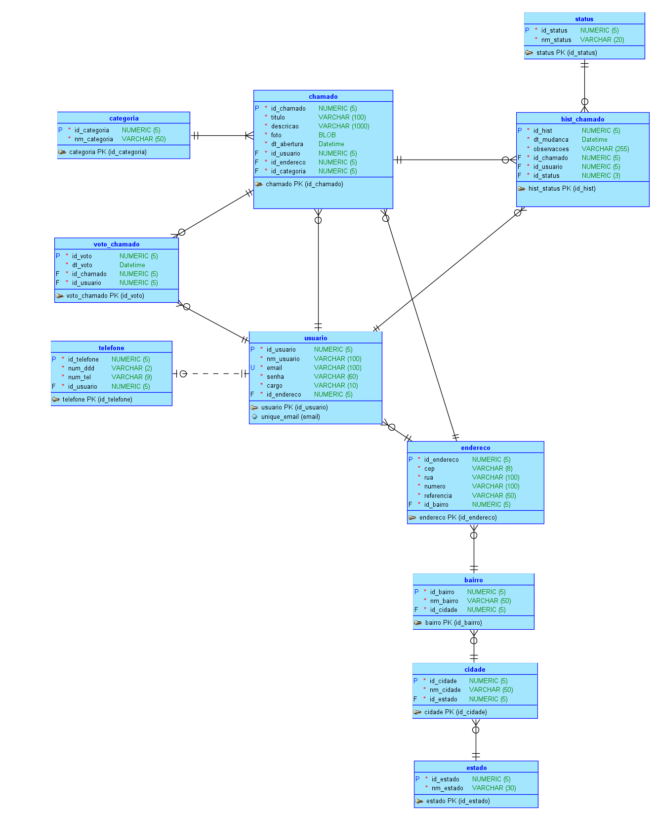
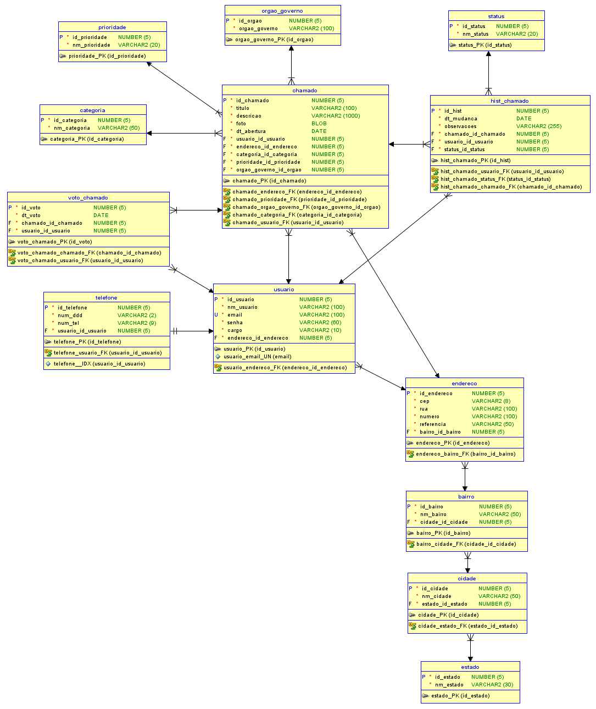

# Database-Advanced — 🏙️ ZelaFix (CitizenTech)
> Banco de dados relacional em 3FN, Packages PL/SQL (`PKG_CHAMADO_GESTAO` e `PKG_ENGAJAMENTO_CIDADAO`), trilha de auditoria DML e persistência poliglota com MongoDB Atlas — FIAP Global Solution 2026/2 — Turma 2TDSPG.

## 💡 Sobre o Problema CitizenTech & Solução ZelaFix (ODS 11)
Grandes centros urbanos sofrem com a demora na identificação e priorização de problemas de zeladoria (buracos em vias, iluminação pública apagada, bueiros obstruídos e queda de árvores), além da falta de transparência sobre o andamento das solicitações. O **ZelaFix** é uma plataforma **CitizenTech** alinhada à **ODS 11 (Cidades e Comunidades Sustentáveis)** que coloca o munícipe no centro da gestão urbana: o cidadão registra ocorrências com evidência fotográfica, a comunidade apoia demandas prioritárias por meio de votos e o poder público acompanha o histórico auditável e a criticidade por bairro.

---

## 👥 Integrantes do Projeto

| Nome | RM | Turma | GitHub | LinkedIn |
| :--- | :---: | :---: | :--- | :--- |
| **Enzo Okuizumi** | **561432** | 2TDSPG | [EnzoOkuizumiFiap](https://github.com/EnzoOkuizumiFiap) | [Enzo Okuizumi](https://www.linkedin.com/in/enzo-okuizumi-b60292256/) |
| **Gustavo Okada** | **563428** | 2TDSPG | [Gdev3356](https://github.com/Gdev3356) | [Gustavo Okada](https://www.linkedin.com/in/gustavo-okada-53a3b8359/) |
| **Lucas Barros Gouveia** | **566422** | 2TDSPG | [LuzBGouveia](https://github.com/LuzBGouveia) | [Lucas Barros Gouveia](https://www.linkedin.com/in/lucas-barros-gouveia-09b147355/) |
| **Luna de Carvalho Guimarães** | **562290** | 2TDSPG | [lunaguima](https://github.com/lunaguima) | [Luna Guimarães](https://www.linkedin.com/in/luna-guimar%C3%A3es-b0ba82309/) |
| **Milton Jakson de Sousa Marcelino** | **564836** | 2TDSPG | [MiltonMarcelino](https://github.com/MiltonMarcelino) | [Milton Marcelino](https://www.linkedin.com/in/milton-marcelino-250298142) |

---

## 🔗 Links e Estrutura Oficial de Arquivos da Entrega

* **Repositório GitHub:** https://github.com/Global-Solution-CitizenTech/Database-Advanced
* **Identificação do Grupo:** [`identificacao.txt`](./identificacao.txt)
* **Documentação Completa c/ Prints (PDF):** [`Documentação Database Advanced GS 2 - ZelaFix.pdf`](./docs/Documenta%C3%A7%C3%A3o%20Database%20Advanced%20GS%202%20-%20ZelaFix.pdf)
* **Modelagem Data Modeler:** [Pasta `data modeler/`](./data%20modeler) (`citizenTech.dmd` e `citizenTech.ddl`)
* **Script SQL Relacional (DDL 3FN + Carga de Dados):** [`2TDSPG_2026_CodigoSql_ZelaFix.sql`](./2TDSPG_2026_CodigoSql_ZelaFix.sql)
* **Script PL/SQL Avançado (Packages, Triggers, Blocos e Testes):** [`2TDSPG_2026_Pacotes_ZelaFix.sql`](./2TDSPG_2026_Pacotes_ZelaFix.sql)
* **Script Oracle — Relatórios Equivalentes (comparação com o MongoDB):** [`2TDSPG_2026_Relatorios_Oracle_ZelaFix.sql`](./2TDSPG_2026_Relatorios_Oracle_ZelaFix.sql)
* **Pasta de Artefatos NoSQL MongoDB:** [`mongodb/`](./mongodb)
  * **Dataset de Chamados Enriquecidos:** [`chamados_dataset.json`](./mongodb/chamados_dataset.json)
  * **Dataset de Bairros Monitorados:** [`bairros_dataset.json`](./mongodb/bairros_dataset.json)
  * **Script NoSQL — Coleção `chamados`:** [`setup_mongodb_chamados.js`](./mongodb/setup_mongodb_chamados.js)
  * **Script NoSQL — Coleção `bairros_monitoramento`:** [`setup_mongodb_bairros.js`](./mongodb/setup_mongodb_bairros.js)
  * **Script NoSQL — 3 Consultas e Relatórios Analíticos:** [`consultas_relatorios_mongodb.js`](./mongodb/consultas_relatorios_mongodb.js)

---

## 📐 Modelagem Relacional Oracle (13 Tabelas em 3FN)

O modelo de dados do **ZelaFix** foi modelado no **Oracle SQL Developer Data Modeler 24.3** em **3ª Forma Normal (3FN)** e cobre a abertura de chamados, o histórico de status e o engajamento comunitário:

### 1. Modelo Lógico


### 2. Modelo Relacional


### Decisões de Modelagem, Indexação e Integridade:
1. **Status do chamado derivado do histórico (3FN + `PRAGMA UDF`):** O status vigente não é duplicado na tabela `chamado`. A evolução completa vive na tabela `hist_chamado` (`dt_mudanca`, `observacoes`, `status_id_status`). O status atual é obtido pela função empacotada `pkg_chamado_gestao.fn_obter_status_atual(id_chamado)` que lê o registro mais recente com `ORDER BY h.id_hist DESC FETCH FIRST 1 ROW ONLY`, usando o índice composto `idx_hist_chamado_ativo`. A função usa `PRAGMA UDF` para reduzir o custo de troca de contexto entre SQL e PL/SQL quando é chamada dentro de consultas.
2. **Índice composto (`idx_hist_chamado_ativo`):** Criado sobre `(chamado_id_chamado, id_hist DESC, status_id_status)`. Como o índice já inclui `status_id_status`, o Oracle localiza o último status de um chamado por *Index Range Scan*, sem subconsulta com `MAX`.
3. **Sem índice redundante em `voto_chamado`:** as consultas por `chamado_id_chamado` usam a *leading column* da constraint `UNIQUE voto_chamado_un (chamado_id_chamado, usuario_id_usuario)`, então não foi criado um índice separado para essa coluna.
4. **Separação de Autoria vs. Apoio Comunitário (N:M):**
   - **Autoria (1:N):** `chamado.usuario_id_usuario` referencia exclusivamente o munícipe que abriu o chamado com foto.
   - **Apoios Comunitários (N:M):** `voto_chamado (chamado_id_chamado, usuario_id_usuario)` é a tabela associativa que permite que a vizinhança apoie a resolução rápida do problema, com a constraint `voto_chamado_un UNIQUE` para impedir voto duplicado. O autovoto é bloqueado por `pr_registrar_voto` e, em `INSERT` direto, pela trigger `trg_valida_voto_chamado`.
5. **Evidência Fotográfica Binária Nativa (`BLOB`):** A coluna `foto` na tabela `chamado` armazena diretamente os bytes das imagens no Oracle, eliminando riscos de URLs externas quebradas (404) durante a apresentação presencial da banca.
6. **Mesmos valores de ENUM no Oracle, no MongoDB e no Java (Spring Boot):** As `CHECK` constraints do Oracle e os `$jsonSchema` do MongoDB usam os mesmos valores dos cinco `enums` da API Java. Cada camada mantém sua própria cópia da lista, então um valor novo precisa ser incluído nas três:
   - `usuario.cargo`: `CIDADAO`, `GESTOR`, `ADMIN`
   - `categoria.nm_categoria`: `ILUMINACAO_PUBLICA`, `VIAS_E_PAVIMENTACAO`, `DRENAGEM_E_ESGOTO`, `LIMPEZA_URBANA`, `ARVORES_E_PARQUES`, `SINALIZACAO_E_TRANSITO`
   - `status.nm_status`: `PENDENTE`, `EM_ANALISE`, `EM_EXECUCAO`, `CONCLUIDO`, `REJEITADO`
   - `prioridade.nm_prioridade`: `BAIXA`, `MEDIA`, `ALTA`, `URGENTE`
   - `orgao_governo.orgao_governo`: `SECRETARIA_OBRAS`, `CET_TRANSITO`, `ILUMINACAO_PUBLICA`, `DEFESA_CIVIL`, `SUBPREFEITURA`, `SANEAMENTO_BASICO`

A criticidade do bairro (`CRITICO`, `ALERTA`, `NORMAL`) não é um enum Java: existe só na função Oracle `fn_classificar_criticidade_bairro` e no MongoDB (`bairros_monitoramento`).

---

## 📦 Arquitetura PL/SQL Avançada (Packages, Funções, Procedures e Auditoria)

O arquivo [`2TDSPG_2026_Pacotes_ZelaFix.sql`](./2TDSPG_2026_Pacotes_ZelaFix.sql) reúne os packages, as triggers, os blocos anônimos e a bateria de testes exigidos pela disciplina:

### 1. Pacote 1: `PKG_CHAMADO_GESTAO` (Ciclo de Vida do Chamado e Serialização Manual)
- **`pr_abrir_chamado`**: Abertura transacional atômica com validações de tamanho mínimo, foto BLOB obrigatória, integridade referencial de chaves estrangeiras (`usuario`, `endereco`, `categoria`, `prioridade`, `orgao_governo`), localização do status `PENDENTE` e gravação simultânea na tabela `chamado` e na linha do tempo `hist_chamado` (3FN estrita) via `RETURNING id_chamado INTO v_novo_id`.
- **`pr_atualizar_status_chamado`**: Valida a existência de chamado, status e usuário fiscal e restringe a alteração a usuários com `cargo IN ('GESTOR', 'ADMIN')`, inserindo uma nova etapa com observações em `hist_chamado`.
- **`fn_obter_status_atual`**: Função (`PRAGMA UDF`) que devolve o status vigente lendo o registro de maior `id_hist` do chamado, com apoio do índice `idx_hist_chamado_ativo`.
- **`fn_converter_chamado_json` (conversão manual)**:
  - **Sem funções SQL/JSON nativas** (`JSON_OBJECT`, `JSON_ARRAYAGG`): monta o documento JSON em `CLOB` com `DBMS_LOB.CREATETEMPORARY` e `DBMS_LOB.WRITEAPPEND`.
  - Serializa o chamado com objetos aninhados (`categoria`, `prioridade`, `orgaoGoverno`, `cidadao`, `localizacao`), escape de caracteres especiais pela função auxiliar `fn_escapar_json` (barra invertida, aspas e todos os caracteres de controle U+0000 a U+001F, conforme a RFC 8259) e o array embutido de histórico de status (`historicoStatus`) via cursor explícito.

### 2. Pacote 2: `PKG_ENGAJAMENTO_CIDADAO` (Inteligência Coletiva e Controle Territorial)
- **`pr_registrar_voto`**: Registra o apoio da comunidade ao chamado (relação N:M em `voto_chamado`), bloqueando autovoto (`v_autor_chamado = p_id_usuario`), duplicidade e impedindo votos em ocorrências já encerradas (`CONCLUIDO` ou `REJEITADO`).
- **`fn_calcular_total_votos`**: Função `PRAGMA UDF` que conta os apoios de um chamado, usando a *leading column* do índice único de `voto_chamado`.
- **`fn_classificar_criticidade_bairro`**: Classifica o bairro pelos chamados pendentes (`PENDENTE`, `EM_ANALISE`, `EM_EXECUCAO`) e pelos apoios acumulados: `'CRITICO'` com 3 ou mais pendentes ou 5 ou mais apoios; `'ALERTA'` com 1 ou mais pendentes ou 2 ou mais apoios; `'NORMAL'` nos demais casos.
- **`pr_relatorio_subtotal_bairros` (Subtotais e Totais Gerais Feitos à Mão)**:
  - Implementa **quebra de grupo clássica (Control Break)** através de cursor explícito ordenado por `(b.nm_bairro, ch.id_chamado)`.
  - **Acumuladores Manuais em Variáveis PL/SQL**: Calcula à mão `v_sub_chamados`, `v_sub_pendentes`, `v_sub_concluidos`, `v_sub_rejeitados` e `v_sub_votos` a cada transição de bairro. Chamados `REJEITADO` são contados à parte e não entram nos pendentes.
  - Ao final do loop, emite o subtotal do último grupo e imprime o **TOTAL GERAL MUNICIPAL** com contagens consolidadas e cálculo manual da **Taxa de Conclusão (%)**, com os chamados rejeitados fora do denominador.
  - **Sem `ROLLUP`**: os subtotais e o total geral vêm de acumuladores em variáveis PL/SQL.

### 3. Tratamento de Exceções
As rotinas tratam exceções específicas antes do `WHEN OTHERS`, entre elas:
- `WHEN NO_DATA_FOUND THEN`: Captura registros inexistentes e retorna mensagens claras via `RAISE_APPLICATION_ERROR`.
- `WHEN DUP_VAL_ON_INDEX THEN`: Intercepta violações de unicidade (como repetição de voto comunitário).
- `WHEN VALUE_ERROR THEN`: Trata erros de conversão de tipos de dados ou estouros de buffers.
- `WHEN ZERO_DIVIDE THEN`: Protege cálculos de taxas percentuais quando o divisor for zero.
- **Exceções Customizadas de Negócio**: Declaradas no pacote e associadas a códigos de erro específicos via `PRAGMA EXCEPTION_INIT` (faixa `-20001` a `-20023`), tais como `e_chamado_fechado`, `e_autovoto_proibido`, `e_usuario_nao_gestor`.
- `WHEN OTHERS THEN`: Utilizado exclusivamente como salvaguarda no final dos blocos após todas as exceções específicas terem sido tratadas.

### 4. Trilha de Auditoria DML e Regras de Negócio em Triggers
- **`TRG_AUDIT_CHAMADO`**: Trigger disparada após qualquer `INSERT`, `UPDATE` ou `DELETE` na tabela `CHAMADO`, gravando o usuário conectado (`USER`), carimbo de data/hora (`SYSTIMESTAMP`), operação executada e os snapshots dos dados anteriores (`:OLD`) e novos (`:NEW`) serializados manualmente em JSON na tabela `AUDITORIA_DML_CHAMADO`. Os snapshots trazem os campos principais do chamado (id, título, categoria, prioridade, órgão e usuário). Se a gravação da auditoria falhar, a trigger levanta erro (`-20022` ou `-20023`) e o DML original é desfeito.
- **`TRG_VALIDA_VOTO_CHAMADO`**: Trigger de validação cívica antes do `INSERT` em `VOTO_CHAMADO`, garantindo no nível do SGBD o bloqueio de autovoto e de votos em chamados já finalizados.

### 5. Dois Blocos Anônimos PL/SQL
- **Bloco Anônimo 1 (Diagnóstico Territorial)**: Processamento em lote com cursor explícito, loop de repetição, estruturas de decisão `IF/ELSIF/ELSE`, invocação de funções empacotadas e cálculo da taxa percentual de resolução urbana.
- **Bloco Anônimo 2 (Painel de Auditoria de SLA)**: Auditoria operacional de ocorrências abertas há 3 dias ou mais sem conclusão, avaliando apoio popular e identificando gargalos da zeladoria.

### 6. Bateria de Testes de Integração (Parte 5)
1. **Teste 1 (Pacote 1):** Abertura atômica de chamado com foto BLOB, transição de status por gestor (`PENDENTE` $\rightarrow$ `EM_ANALISE`) e geração manual de JSON com histórico em CLOB.
2. **Teste 2 (Pacote 2 e Trigger):** Registro de apoio comunitário, totalização de votos e quatro bloqueios: voto duplicado (`e_voto_duplicado`), autovoto pela procedure (`e_autovoto_proibido`), autovoto por `INSERT` direto (barrado pela trigger `trg_valida_voto_chamado`) e voto em chamado `CONCLUIDO` (`e_chamado_fechado`). Se um bloqueio não ocorrer, o teste imprime `FALHA`.
3. **Teste 3 (Subtotais):** Emissão do relatório territorial com quebra de grupo, subtotais e total geral feitos à mão (`pr_relatorio_subtotal_bairros`).
4. **Teste 4 (Auditoria DML):** Execução de `UPDATE` na prioridade do chamado 1 (`3-ALTA` $\rightarrow$ `4-URGENTE`) e listagem dos snapshots JSON completos (`valores_anteriores` vs. `valores_novos`) gravados pela trigger `TRG_AUDIT_CHAMADO` em `AUDITORIA_DML_CHAMADO`.
5. **Teste 5 (Escape JSON):** Validação da função `fn_escapar_json` com aspas, barra invertida, quebra de linha, tabulação e caracteres de controle (`\u00XX`).
- Finalizado com comando `ROLLBACK;` para preservação das sementes de teste.

---

## 🔄 Matriz de Mapeamento: Do Relacional ao MongoDB

A transição do modelo relacional para documentos adota escolhas entre **documentos incorporados (*embedding*)** e **referências (*referencing*)**:

| Conceito / Entidade Relacional (Oracle) | Representação NoSQL (MongoDB) | Padrão Adotado | Justificativa Técnica da Transição |
| :--- | :--- | :---: | :--- |
| `chamado` + `usuario` + `endereco` + `bairro` + `cidade` + `prioridade` + `orgao_governo` | Documento raiz `chamados` com subdocumentos `cidadao`, `localizacao` e `triagem_ia` | **Embedding** | Leituras atômicas: o aplicativo móvel do cidadão recupera todo o contexto do chamado, prioridade e órgão responsável em uma única leitura, sem joins. |
| `hist_chamado` (Linha do tempo) | Array embutido `historico: [ { data, status, observacao, responsavel } ]` | **Embedding** | O histórico de status é delimitado e raramente ultrapassa 10 eventos por chamado, tornando ideal a incorporação de acordo com o padrão *Document Versioning*. |
| `voto_chamado` (Apoios populares) | Array embutido `votos: [ { id_usuario, nome, dt_voto } ]` | **Embedding** | Preserva a rastreabilidade de quem apoiou a ocorrência diretamente no documento principal. |
| Total de votos computado | Campo desnormalizado `total_votos: NumberInt` | **Desnormalização Controlada** | No Oracle, a contagem exige `COUNT(v.id_voto)` com `GROUP BY`. No MongoDB, o total é armazenado diretamente para permitir índice ordenado (`{ total_votos: -1 }`) e ranking instantâneo. |
| Gestão Territorial das Subprefeituras | Coleção separada `bairros_monitoramento` | **Referencing Lógico** | Bairros são entidades de análise autônoma com ciclo de vida independente dos chamados. O vínculo é mantido pelo campo lógico `id_bairro`. |
| `categoria` e `status` (tabelas de domínio) | Campos de texto `categoria`, `status_atual` e `historico[].status`, com `enum` no `$jsonSchema` | **Valor por extenso** | As tabelas de apoio só guardam o nome; gravar o texto elimina o JOIN, e o `enum` mantém o mesmo domínio dos `CHECK` do Oracle. `status_atual` é o último evento de `hist_chamado` (o que `fn_obter_status_atual` devolve). |

> **Fora da migração, por decisão:** `usuario.senha` (hash de credencial não deve ir para a base analítica) e `telefone` (contato sem uso nos relatórios).
>
> **Só existe no MongoDB:** em `bairros_monitoramento`, `subprefeitura`, `zona` e `populacao_estimada` são dados de referência territorial, sem coluna correspondente no Oracle. Já `metricas` (totais de chamados, pendentes, concluídos, apoios e `tempo_medio_resolucao_horas`) e `criticidade` são derivados dos dados do Oracle: as métricas coincidem com o Relatório 3 e a criticidade segue a regra de `fn_classificar_criticidade_bairro`.

---

## 📊 Relatórios Analíticos: Comparação Direta Oracle SQL vs. MongoDB

### Relatório 1: Ocorrências Ativas com Maior Apoio Comunitário (Radar do Bairro)
> **Objetivo de Negócio:** Priorizar na esteira da Subprefeitura os chamados abertos mais votados pela vizinhança.

* **MongoDB:**
  ```javascript
  db.chamados.find(
    { status_atual: { $nin: ["CONCLUIDO", "REJEITADO"] } },
    { _id: 0, id_chamado: 1, titulo: 1, categoria: 1, "localizacao.bairro": 1, total_votos: 1, status_atual: 1 }
  ).sort({ total_votos: -1, id_chamado: 1 });
  ```
* **Oracle SQL:**
  ```sql
  SELECT c.id_chamado, c.titulo, cat.nm_categoria, b.nm_bairro,
         COUNT(v.id_voto) AS total_votos,
         pkg_chamado_gestao.fn_obter_status_atual(c.id_chamado) AS status_atual
    FROM chamado c
    JOIN categoria cat ON cat.id_categoria = c.categoria_id_categoria
    JOIN endereco e ON e.id_endereco = c.endereco_id_endereco
    JOIN bairro b ON b.id_bairro = e.bairro_id_bairro
    LEFT JOIN voto_chamado v ON v.chamado_id_chamado = c.id_chamado
   WHERE pkg_chamado_gestao.fn_obter_status_atual(c.id_chamado) NOT IN ('CONCLUIDO', 'REJEITADO')
   GROUP BY c.id_chamado, c.titulo, cat.nm_categoria, b.nm_bairro,
            pkg_chamado_gestao.fn_obter_status_atual(c.id_chamado)
   ORDER BY total_votos DESC, c.id_chamado ASC;
  ```

* **Resultado Comparativo Obtido:**

| ID Chamado | Título | Bairro | Categoria | Status Atual | Votos (Apoios) |
| :---: | :--- | :--- | :--- | :---: | :---: |
| **1** | Poste com lâmpada apagada em via principal | Bela Vista | `ILUMINACAO_PUBLICA` | `EM_EXECUCAO` | **2** |
| **2** | Buraco profundo na faixa da direita da via | Pinheiros | `VIAS_E_PAVIMENTACAO` | `EM_ANALISE` | **2** |
| **4** | Descarte irregular de entulho e móveis velhos | Mooca | `LIMPEZA_URBANA` | `PENDENTE` | **2** |
| **5** | Galho de grande porte com risco de queda sobre fiação elétrica | Santana | `ARVORES_E_PARQUES` | `EM_ANALISE` | **2** |
| **7** | Vazamento contínuo de água limpa no meio-fio | Pinheiros | `DRENAGEM_E_ESGOTO` | `EM_EXECUCAO` | **0** |

---

### Relatório 2: Agrupamento por Categoria Urbana e Volume de Ocorrências (Aggregation)
> **Objetivo de Negócio:** Mapear os gargalos operacionais e serviços com maior demanda reprimida para planejamento público.

* **MongoDB (Aggregation Pipeline com `$group` e `$sort`):**
  ```javascript
  db.chamados.aggregate([
    {
      $group: {
        _id: "$categoria",
        total_ocorrencias: { $sum: 1 },
        total_votos_acumulados: { $sum: "$total_votos" },
        ocorrencias_abertas: {
          $sum: {
            $cond: [
              { $in: ["$status_atual", ["PENDENTE", "EM_ANALISE", "EM_EXECUCAO"]] },
              1,
              0
            ]
          }
        },
        ocorrencias_concluidas: {
          $sum: {
            $cond: [{ $eq: ["$status_atual", "CONCLUIDO"] }, 1, 0]
          }
        }
      }
    },
    { $sort: { total_ocorrencias: -1, total_votos_acumulados: -1, _id: 1 } }
  ]);
  ```
* **Oracle SQL:**
  ```sql
  SELECT cat.nm_categoria AS categoria,
         COUNT(c.id_chamado) AS total_ocorrencias,
         SUM(CASE WHEN pkg_chamado_gestao.fn_obter_status_atual(c.id_chamado) IN ('PENDENTE', 'EM_ANALISE', 'EM_EXECUCAO') THEN 1 ELSE 0 END) AS ocorrencias_abertas,
         SUM(CASE WHEN pkg_chamado_gestao.fn_obter_status_atual(c.id_chamado) = 'CONCLUIDO' THEN 1 ELSE 0 END) AS ocorrencias_concluidas,
         SUM(NVL(v.qtd_votos, 0)) AS total_votos_acumulados
    FROM categoria cat
    LEFT JOIN chamado c ON c.categoria_id_categoria = cat.id_categoria
    LEFT JOIN (SELECT chamado_id_chamado, COUNT(*) AS qtd_votos
                 FROM voto_chamado
                GROUP BY chamado_id_chamado) v ON v.chamado_id_chamado = c.id_chamado
   GROUP BY cat.nm_categoria
   ORDER BY total_ocorrencias DESC, total_votos_acumulados DESC, cat.nm_categoria ASC;
  ```
  > Os apoios são somados por chamado numa subconsulta. Um `LEFT JOIN` direto com `voto_chamado` repetiria cada chamado uma vez por apoio e inflaria `COUNT` e `SUM`. O mesmo vale para o Relatório 3.

* **Resultado Comparativo Obtido:**

| Categoria Urbana | Total de Ocorrências | Ocorrências Abertas | Ocorrências Concluídas | Votos Acumulados |
| :--- | :---: | :---: | :---: | :---: |
| **`LIMPEZA_URBANA`** | 2 | 1 | 0 | 2 |
| **`DRENAGEM_E_ESGOTO`** | 2 | 1 | 1 | 0 |
| **`ARVORES_E_PARQUES`** | 1 | 1 | 0 | 2 |
| **`ILUMINACAO_PUBLICA`** | 1 | 1 | 0 | 2 |
| **`VIAS_E_PAVIMENTACAO`** | 1 | 1 | 0 | 2 |
| **`SINALIZACAO_E_TRANSITO`** | 1 | 0 | 1 | 0 |

---

### Relatório 3: Diagnóstico Territorial de Criticidade por Bairro (Aggregation Avançado)
> **Objetivo de Negócio:** Calcular a taxa percentual de pendência territorial para alocação de mutirões da Zeladoria Urbana.

* **MongoDB (Pipeline com `$group`, `$project` com operadores matemáticos e `$sort`):**
  ```javascript
  db.chamados.aggregate([
    {
      $group: {
        _id: "$localizacao.bairro",
        cidade: { $first: "$localizacao.cidade" },
        total_chamados: { $sum: 1 },
        votos_totais: { $sum: "$total_votos" },
        chamados_pendentes: {
          $sum: {
            $cond: [{ $in: ["$status_atual", ["PENDENTE", "EM_ANALISE", "EM_EXECUCAO"]] }, 1, 0]
          }
        },
        chamados_resolvidos: {
          $sum: {
            $cond: [{ $eq: ["$status_atual", "CONCLUIDO"] }, 1, 0]
          }
        }
      }
    },
    {
      $project: {
        _id: 0,
        bairro: "$_id",
        cidade: 1,
        total_chamados: 1,
        votos_totais: 1,
        chamados_pendentes: 1,
        chamados_resolvidos: 1,
        taxa_pendencia_pct: {
          $round: [
            {
              $multiply: [
                { $divide: ["$chamados_pendentes", "$total_chamados"] },
                100
              ]
            },
            1
          ]
        }
      }
    },
    { $sort: { chamados_pendentes: -1, votos_totais: -1, bairro: 1 } }
  ]);
  ```
* **Oracle SQL:**
  ```sql
  SELECT b.nm_bairro AS bairro,
         c.nm_cidade AS cidade,
         COUNT(ch.id_chamado) AS total_chamados,
         SUM(CASE WHEN pkg_chamado_gestao.fn_obter_status_atual(ch.id_chamado) IN ('PENDENTE', 'EM_ANALISE', 'EM_EXECUCAO') THEN 1 ELSE 0 END) AS chamados_pendentes,
         SUM(CASE WHEN pkg_chamado_gestao.fn_obter_status_atual(ch.id_chamado) = 'CONCLUIDO' THEN 1 ELSE 0 END) AS chamados_resolvidos,
         ROUND((SUM(CASE WHEN pkg_chamado_gestao.fn_obter_status_atual(ch.id_chamado) IN ('PENDENTE', 'EM_ANALISE', 'EM_EXECUCAO') THEN 1 ELSE 0 END) / COUNT(ch.id_chamado)) * 100, 1) AS taxa_pendencia_pct,
         SUM(NVL(v.qtd_votos, 0)) AS votos_totais
    FROM bairro b
    JOIN cidade c ON c.id_cidade = b.cidade_id_cidade
    JOIN endereco e ON e.bairro_id_bairro = b.id_bairro
    JOIN chamado ch ON ch.endereco_id_endereco = e.id_endereco
    LEFT JOIN (SELECT chamado_id_chamado, COUNT(*) AS qtd_votos
                 FROM voto_chamado
                GROUP BY chamado_id_chamado) v ON v.chamado_id_chamado = ch.id_chamado
   GROUP BY b.nm_bairro, c.nm_cidade
   ORDER BY chamados_pendentes DESC, votos_totais DESC, b.nm_bairro ASC;
  ```

* **Resultado Comparativo Obtido:**

| Bairro | Cidade | Total de Chamados | Pendentes | Resolvidos | Taxa de Pendência (%) | Total de Apoios |
| :--- | :--- | :---: | :---: | :---: | :---: | :---: |
| **Pinheiros** | São Paulo | 2 | **2** | 0 | **100.0%** | 2 |
| **Bela Vista** | São Paulo | 2 | **1** | 1 | **50.0%** | 2 |
| **Mooca** | São Paulo | 1 | **1** | 0 | **100.0%** | 2 |
| **Santana** | São Paulo | 1 | **1** | 0 | **100.0%** | 2 |
| **Sé** | São Paulo | 2 | **0** | 1 | **0.0%** | 0 |

---

## 🚀 Guia Passo a Passo de Execução

### Opção 1: Execução no Oracle Database (SQL Developer / SQLcl / VS Code)

1. **Passo 1 — Carga DDL e Sementes Relacionais:**
   - Execute o script [`2TDSPG_2026_CodigoSql_ZelaFix.sql`](./2TDSPG_2026_CodigoSql_ZelaFix.sql).
   - Ele limpa o ambiente de forma idempotente, cria as 13 tabelas em 3FN (`estado`, `cidade`, `bairro`, `endereco`, `usuario`, `telefone`, `categoria`, `status`, `prioridade`, `orgao_governo`, `chamado`, `hist_chamado`, `voto_chamado`) + tabela de auditoria (`auditoria_dml_chamado`), cria as PKs, FKs, constraints e insere as sementes válidas com `COMMIT`.
2. **Passo 2 — Empacotamento PL/SQL, Triggers e Testes:**
   - Execute o script [`2TDSPG_2026_Pacotes_ZelaFix.sql`](./2TDSPG_2026_Pacotes_ZelaFix.sql).
   - Ele compila as packages `PKG_CHAMADO_GESTAO` e `PKG_ENGAJAMENTO_CIDADAO`, as triggers `TRG_AUDIT_CHAMADO` e `TRG_VALIDA_VOTO_CHAMADO`, os 2 blocos anônimos e roda a bateria de testes de integração com `DBMS_OUTPUT` e `ROLLBACK` seguro.
3. **Passo 3 — Relatórios Oracle equivalentes aos do MongoDB:**
   - Execute [`2TDSPG_2026_Relatorios_Oracle_ZelaFix.sql`](./2TDSPG_2026_Relatorios_Oracle_ZelaFix.sql) depois do Passo 2. São as mesmas 3 consultas da seção de relatórios acima, e a saída coincide com as tabelas "Resultado Comparativo Obtido".

---

### Opção 2: Carga e Consultas no MongoDB (MongoDB Compass ou mongosh)

Todos os artefatos residem na pasta [`mongodb/`](./mongodb).

> 💡 **Nota de Conexão Atlas para Avaliação:** Substitua `<usuario>` e `<senha>` pelas credenciais do cluster oficial da equipe no MongoDB Atlas (configuradas no arquivo `.env` / painel da disciplina):
> `mongodb+srv://<usuario>:<senha>@zelafix.t2rxvpu.mongodb.net/zelafix`

#### Execução no MongoDB Compass (Aba `>_MONGOSH`):
1. Abra o **MongoDB Compass** e conecte-se com a URI do cluster acima (certifique-se de estar na aba do cluster `zelafix`, e não em `localhost:27017`).
2. Abra a aba inferior **`>_MONGOSH`**.
3. Como os scripts utilizam `use("zelafix")` e já trazem os datasets embutidos de forma autossuficiente (sem depender de `load()`, `process.chdir()` ou caminhos locais), basta **colar e executar** o conteúdo de cada arquivo `.js` em sequência (`setup_mongodb_chamados.js` $\rightarrow$ `setup_mongodb_bairros.js` $\rightarrow$ `consultas_relatorios_mongodb.js`).
   > *(Os arquivos `chamados_dataset.json` e `bairros_dataset.json` contêm exatamente os mesmos dados em formato JSON puro para importação manual opcional via **Add Data → Import JSON** do Compass.)*

#### Execução via Linha de Comando (`mongosh`):
```bash
cd Database-Advanced/mongodb

# 1. Carga da Coleção 'chamados'
mongosh "mongodb+srv://<usuario>:<senha>@zelafix.t2rxvpu.mongodb.net/zelafix" setup_mongodb_chamados.js

# 2. Carga da Coleção 'bairros_monitoramento'
mongosh "mongodb+srv://<usuario>:<senha>@zelafix.t2rxvpu.mongodb.net/zelafix" setup_mongodb_bairros.js

# 3. Execução dos 3 Relatórios Analíticos (Aggregation Pipeline)
mongosh "mongodb+srv://<usuario>:<senha>@zelafix.t2rxvpu.mongodb.net/zelafix" consultas_relatorios_mongodb.js
```

---

## 🧪 Evidências de Validação e Integridade

> 📄 **Prints completos de execução** (Oracle SQL Developer + MongoDB Compass / Atlas) disponíveis no documento oficial em PDF: [`docs/Documentação Database Advanced GS 2 - ZelaFix.pdf`](./docs/Documenta%C3%A7%C3%A3o%20Database%20Advanced%20GS%202%20-%20ZelaFix.pdf).

Ao executar [`consultas_relatorios_mongodb.js`](./mongodb/consultas_relatorios_mongodb.js), as saídas no console correspondem aos resultados das consultas Oracle equivalentes:

```text
====================================================================
  ZELAFIX CITIZENTECH — RELATÓRIOS ANALÍTICOS NoSQL (MONGODB)
  Execução dos 3 Relatórios Obrigatórios (Edital GS2 - Págs 70-76)
====================================================================

>>> RELATÓRIO 1: Ocorrências Ativas com Maior Apoio Comunitário (Filtro: Ativos | Order: total_votos DESC)
+-------+----------------------------------------------+----------------+------------------------+--------------+----------+
| ID    | TÍTULO DA OCORRÊNCIA                         | BAIRRO         | CATEGORIA              | STATUS       | APOIOS   |
+-------+----------------------------------------------+----------------+------------------------+--------------+----------+
|     1 | Poste com lâmpada apagada em via principal   | Bela Vista     | ILUMINACAO_PUBLICA     | EM_EXECUCAO  |        2 |
|     2 | Buraco profundo na faixa da direita da via   | Pinheiros      | VIAS_E_PAVIMENTACAO    | EM_ANALISE   |        2 |
|     4 | Descarte irregular de entulho e móveis ve... | Mooca          | LIMPEZA_URBANA         | PENDENTE     |        2 |
|     5 | Galho de grande porte com risco de queda ... | Santana        | ARVORES_E_PARQUES      | EM_ANALISE   |        2 |
|     7 | Vazamento contínuo de água limpa no meio-fio | Pinheiros      | DRENAGEM_E_ESGOTO      | EM_EXECUCAO  |        0 |
+-------+----------------------------------------------+----------------+------------------------+--------------+----------+

>>> RELATÓRIO 2 (AGGREGATION): Volume de Ocorrências e Gargalos por Categoria Urbana
+----------------------------+---------+------------+-------------+----------------+
| CATEGORIA URBANA           | TOTAL   | PENDENTES  | CONCLUÍDAS  | APOIOS TOTAIS  |
+----------------------------+---------+------------+-------------+----------------+
| LIMPEZA_URBANA             |       2 |          1 |           0 |              2 |
| DRENAGEM_E_ESGOTO          |       2 |          1 |           1 |              0 |
| ARVORES_E_PARQUES          |       1 |          1 |           0 |              2 |
| ILUMINACAO_PUBLICA         |       1 |          1 |           0 |              2 |
| VIAS_E_PAVIMENTACAO        |       1 |          1 |           0 |              2 |
| SINALIZACAO_E_TRANSITO     |       1 |          0 |           1 |              0 |
+----------------------------+---------+------------+-------------+----------------+

>>> RELATÓRIO 3 (AGGREGATION AVANÇADO): Diagnóstico Territorial de Pendência por Bairro
+------------------+--------------+---------+------------+-------------+--------------+----------+
| BAIRRO           | MUNICÍPIO    | TOTAL   | PENDENTES  | RESOLVIDOS  | PENDÊNCIA %  | APOIOS   |
+------------------+--------------+---------+------------+-------------+--------------+----------+
| Pinheiros        | São Paulo    |       2 |          2 |           0 |         100% |        2 |
| Bela Vista       | São Paulo    |       2 |          1 |           1 |          50% |        2 |
| Mooca            | São Paulo    |       1 |          1 |           0 |         100% |        2 |
| Santana          | São Paulo    |       1 |          1 |           0 |         100% |        2 |
| Sé               | São Paulo    |       2 |          0 |           1 |           0% |        0 |
+------------------+--------------+---------+------------+-------------+--------------+----------+

====================================================================
  EXECUÇÃO CONCLUÍDA COM SUCESSO! DADOS EM HARMONIA COM O ORACLE.
====================================================================
```

---

## 🤖 Declaração de Uso de Inteligência Artificial Generativa

Em cumprimento às diretrizes da Global Solution FIAP:

* **Ferramentas Utilizadas:** **Gemini 3.8 Flash**, **Gemini 4 Hydrogen** e **Claude Sonnet 5.5**.
* **Finalidade de Uso:** Apoio na revisão de sintaxe PL/SQL e MongoDB, validação de casos de borda na suíte de testes, conferência de equivalência entre os relatórios Oracle e MongoDB e revisão textual da documentação.
* **Revisão Humana:** Toda a modelagem relacional em 3FN, regras de negócio, pacotes PL/SQL, triggers, schemas JSON e pipelines de agregação foram projetados, executados e validados pelos integrantes do grupo.
